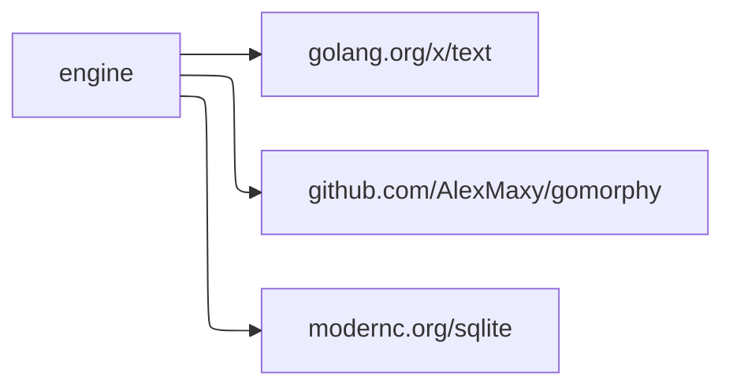

# Architecture

## Package Dependency Diagram

## Package Coupling

Sorted by instability (1.0 = maximally unstable, 0.0 = maximally stable).

| Package | Fan-in (Ca) | Fan-out (Ce) | Instability |
|---------|-------------|--------------|-------------|
| `golang.org/x/text/encoding` | 0 | 0 | isolated |
| `golang.org/x/text/encoding/charmap` | 0 | 0 | isolated |
| `golang.org/x/text/encoding/unicode` | 0 | 0 | isolated |
| `golang.org/x/text/transform` | 0 | 0 | isolated |
| `github.com/AlexMaxy/gomorphy` | 0 | 0 | isolated |
| `modernc.org/sqlite` | 0 | 0 | isolated |

## Topological Layers

Packages grouped by fan-out (0 = foundation/stable, higher = more dependent).

| Layer (fan-out) | Packages |
|-----------------|----------|
| 0 | golang.org/x/text/encoding, golang.org/x/text/encoding/charmap, golang.org/x/text/encoding/unicode, golang.org/x/text/transform, github.com/AlexMaxy/gomorphy, modernc.org/sqlite |

